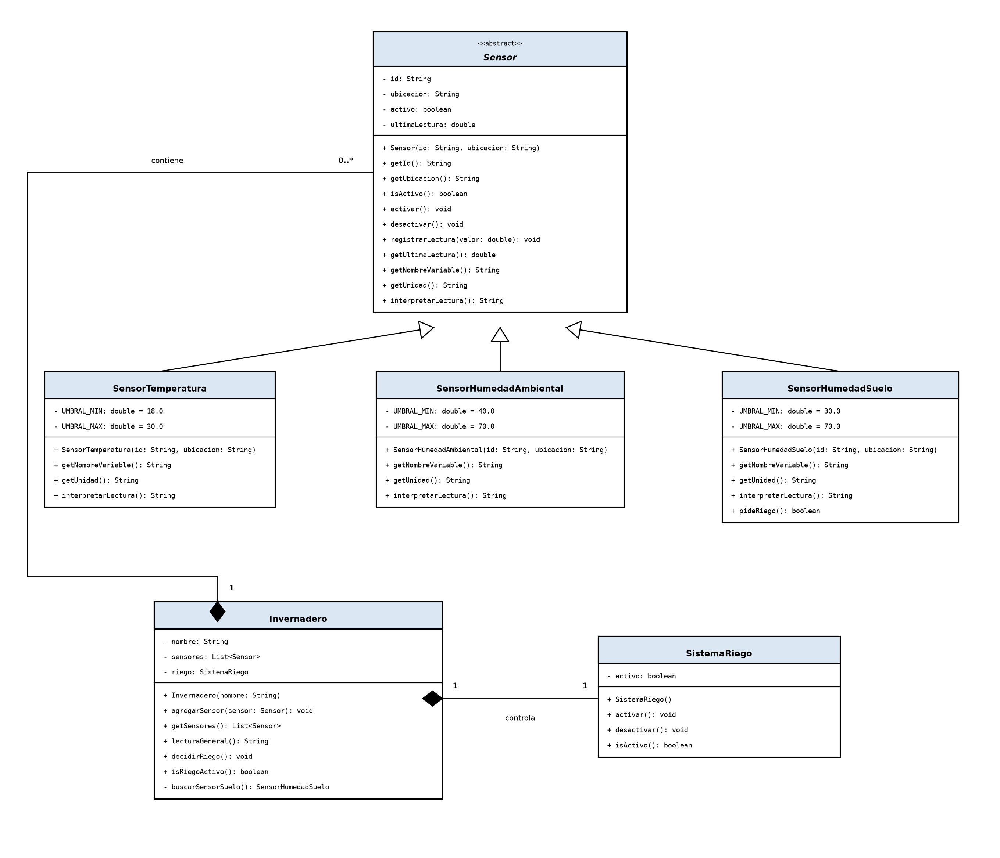

# Análisis y diseño

## 1. Descripción del problema

### ¿Qué sistema se representa?

El sistema que se va a representar es un invernadero inteligente, reducido a lo suficiente
para resolverlo con clases y objetos: un lugar de cultivo del que se obtienen tres mediciones
y sobre el que se puede ejecutar una única acción, el riego.

### ¿Qué información se maneja?

Valores medidos: Cada sensor guarda su última lectura. La temperatura se expresa en grados 
Celsius y las dos humedades en porcentajes de 0 a 100.

Datos del sensor: Un sensor también necesita saber quién es, dónde está instalado y si está
encendido o apagado. Un sensor apagado no debería estar entregando información.

Estado del riego: El sistema de riego necesita recordar si está regando o detenido, porque ese
estado es el resultado de una decisión tomada a partir de una medición.

### ¿Qué elementos intervienen?

Tres sensores, uno por cada variable: temperatura del aire, humedad ambiental y humedad del 
suelo. Los tres se parecen en mucho, pero se diferencian en lo importante: En qué unidad miden 
y cómo se interpreta su lectura. El mismo número significa cosas distintas según el sensor: 
32 °C es "temperatura alta", mientras que 32 % de humedad del suelo es un valor intermedio
considerado adecuado.

Un sistema de riego, que no mide nada. Solo tiene dos estados posibles y su
estado se decide a partir de la humedad del suelo.

### ¿Qué operaciones debe realizar?

- Registrar cada sensor con su identificación, ubicación y estado inicial. 
- Tomar una medición y guardarla como última lectura. 
- Interpretar la medición y devolver un texto con su significado. 
- Informar el estado actual y los datos de cada sensor. 
- Recorrer el conjunto de sensores aplicando la misma operación a todos. 
- Mostrar la interpretación de cada sensor en una lectura general del invernadero. 
- Activar, desactivar e informar el estado del sistema de riego. 
- Decidir el riego a partir de la humedad del suelo.

## 2. Identificación de objetos

### Sensor

Representa a cualquier sensor del invernadero, sin importar qué magnitud mide.

Debería existir como objeto porque los tres sensores comparten casi todo: se
identifican, tienen ubicación, se encienden y se apagan, guardan una última lectura y
saben explicar qué significa esa lectura. Como eso es igual para los tres, no tiene
sentido escribirlo tres veces. Lo que cambia es la unidad y la forma de interpretar el
número, y eso puede quedar resuelto más adelante, con las clases hijas.

De esto se encargaría: guardar identificación, ubicación, estado y última lectura, y
exponer la interpretación de esa lectura.

### Sensor de temperatura

Representa al sensor que mide la temperatura del aire. Hereda de Sensor.

Lo que tiene propio es la unidad, que es el grado Celsius, y sus umbrales.
También conviene que ofrezca un dato extra que los otros no tienen, por ejemplo el
nombre de la variable medida, para poder mostrarlo junto al resto.

De esto se encargaría: registrar su lectura en grados e interpretarla con sus
umbrales, además de mostrar sus detalles propios.

### Sensor de humedad ambiental

Representa al sensor que mide la humedad del aire. También hereda de Sensor.

Lo propio es que su unidad es el porcentaje. Nótese que un
32 % en este sensor significa humedad baja, mientras que en el sensor de suelo esa
misma cifra significa algo distinto. Justamente por eso cada sensor interpreta su
propia lectura.

De esto se encargaría: registrar su lectura como porcentaje e interpretarla con sus
umbrales.

### Sensor de humedad del suelo

Representa al sensor que mide la humedad del suelo donde están las plantas. Hereda de
Sensor igual que los otros dos.

Lo propio es que su lectura tiene un significado especial: es la que decide si se
riega. Además, como es el sensor del que depende una acción, conviene que
diga de forma explícita si su lectura pide riego o no, en lugar de dejar que ese
razonamiento se haga afuera.

De esto se encargaría: registrar su lectura como porcentaje, interpretarla con sus
umbrales e indicar si esa lectura requiere regar.

### Invernadero

Representa el espacio completo: los sensores instalados y el estado del riego.

Debería existir como objeto porque es el lugar donde conviven los demás objetos. Es
quien los tiene guardados y quien puede dar una lectura general del cultivo. 
Como la decisión del riego depende de la humedad del suelo, y esa lectura está dentro del 
invernadero, tiene sentido que sea este objeto el que lea esa medición y cambie su estado de 
riego.

De esto se encargaría: guardar el conjunto de sensores, recorrerlos todos para mostrar
su estado en una sola lectura, y activar o desactivar el riego según lo que indique la
humedad del suelo.

## 3. Estado y comportamiento

| Objeto propuesto | Responsabilidad | Información que debe conservar | Comportamientos que debe realizar |
|---|---|---|---|
| Sensor | Representar un sensor del invernadero, con lo que todos los sensores tienen en común | Identificación, ubicación, si está encendido o apagado y la última lectura que tomó | Permitir conocer su identificación, su ubicación y si está activo; registrar una lectura nueva; permitir conocer su última lectura; interpretar esa lectura diciendo si es baja, adecuada o alta; informar su unidad de medida |
| Sensor de temperatura| Interpretar la lectura en grados Celsius con los umbrales de la temperatura | Nada adicional: la unidad y los umbrales le son propios, pero se deducen del tipo | Interpretar su lectura: menor a 18 °C es baja, entre 18 y 30 °C adecuada, mayor a 30 °C alta; informar el nombre de la variable medida |
| Sensor de humedad ambiental | Interpretar la lectura como porcentaje de humedad del aire | Nada adicional: la unidad y los umbrales le son propios | Interpretar su lectura: menor a 40 % es baja, entre 40 y 70 % adecuada, mayor a 70 % alta |
| Sensor de humedad del suelo | Interpretar la lectura como porcentaje de humedad del suelo | Nada adicional: la unidad y los umbrales le son propios | Interpretar su lectura: menor a 30 % es baja, entre 30 y 70 % adecuada, mayor a 70 % alta; decir de forma explícita si esa lectura pide regar o no |
| Invernadero | Contener los sensores instalados y decidir cuándo se riega | El conjunto de sensores y si el riego está activo o inactivo | Guardar un sensor nuevo; permitir consultar todos los sensores juntos; recorrerlos y mostrar la interpretación de cada lectura; activar y desactivar el riego; preguntar si el riego está activo; decidir el riego a partir de la lectura del sensor de humedad del suelo |

## 4. Características comunes y especialización

### ¿Qué información tienen en común?

Los tres sensores guardan lo mismo: un nombre o identificador, el lugar donde están
instalados, si están encendidos o apagados, y el valor de su última lectura. En eso
ninguno tiene algo que los otros dos no tengan.

### ¿Qué comportamientos tienen en común?

Pueden registrar una lectura nueva, permitir que alguien pregunte cuál fue su última
lectura, encenderse y apagarse, e informar su ubicación e identificador. Todo eso lo
hacen de la misma forma, sin importar qué midan.

### ¿Qué características cambian según el tipo de sensor?

Dos cosas. La unidad, que para la temperatura son grados Celsius y para las dos
humedades es el porcentaje. Y los umbrales con los que se interpreta el número, que
son distintos en cada sensor:

| Sensor | Unidad | Umbrales |
|---|---|---|
| Temperatura | grados Celsius | menos de 18 °C es baja, de 18 a 30 °C adecuada, más de 30 °C alta |
| Humedad ambiental | porcentaje | menos de 40 % es baja, de 40 a 70 % adecuada, más de 70 % alta |
| Humedad del suelo | porcentaje | menos de 30 % es baja, de 30 a 70 % adecuada, más de 70 % alta |

### ¿Existe un concepto general que represente a todos los sensores?

Sí, y está bastante claro: la idea de un sensor. Todos son dispositivos que están
instalados en un lugar, se identifican, se pueden encender y apagar, toman una
medición y pueden decir qué significa esa medición. Esa idea no depende de qué se esté
midiendo, así que sirve para los tres.

Ese es el motivo por el que conviene una clase general de sensor: lo que tienen en
común se escribe una vez, y lo que cambia queda para cada sensor por separado.

### ¿Qué elementos serían especializaciones de ese concepto?

- el sensor de temperatura, que añade su unidad en grados y sus propios umbrales;
- el sensor de humedad ambiental, que añade el porcentaje y sus umbrales;
- el sensor de humedad del suelo, que además tiene algo especial: como su lectura
  decide si se riega, conviene que él mismo diga si esa lectura pide agua o no.

## 5. Relaciones entre objetos

### Qué objetos necesitan colaborar

En este sistema colaboran dos grupos. Por un lado, los sensores entre sí: comparten
la idea de sensor, así que se apoyan unos en otros sin necesidad de conocerse. Por
otro lado, el invernadero con los sensores: los guarda y usa la lectura de la humedad
del suelo para decidir el riego.

El riego, en cambio, no necesita colaborar con nadie. Solo tiene un estado que se
puede cambiar.

### Qué información necesita un objeto de otro

El invernadero necesita dos cosas de los sensores: conocerlos para poder mostrarlos,
y leer la última medición del sensor de humedad del suelo para decidir si riega. No
necesita nada más. En particular no necesita saber de qué clase es cada sensor, ni
mirar sus umbrales: le alcanza con que todos sepan interpretar su propia lectura.

Los sensores, por su parte, no necesitan nada del invernadero. Son independientes
entre sí: el de temperatura no sabe que existe el de humedad. Esa es una buena señal,
porque significa que cada uno puede existir solo.

### Qué relaciones sí pueden representarse mediante herencia

Solo la del concepto sensor con sus tres variantes. Un sensor de temperatura es un
sensor, y también lo son los otros dos. Eso se resuelve con una clase general y tres
que se apoyan en ella.

Lo que se escribe en la clase general es exactamente lo que los tres hacen igual:
identificarse, decir dónde están, encenderse y apagarse, registrar una lectura,
permitir consultar la última e interpretarla. Lo que cambia, que es la unidad y los
umbrales, queda en cada sensor por separado.

### Qué relaciones no deberían representarse mediante herencia

La del invernadero con los sensores. El invernadero no es un sensor ni una versión
más limitada de él: no mide nada, no tiene ubicación ni lectura propia, no se enciende
y apagarse porque no mide. Si el invernadero heredara de sensor, heredaría cosas que
no le sirven y tendría que inventar formas raras de cumplir behaviors que no le
corresponden.

Su relación con los sensores es simplemente que los contiene.

### Qué responsabilidades no deberían duplicarse

Identificarse, decir su ubicación, encenderse y apagarse, registrar y devolver su
última lectura, e informar su unidad. Eso es idéntico en los tres sensores y debe
escribirse una sola vez. Si además se escribiera en cada sensor, el día que cambie la
forma de guardar la lectura habría que tocarla en tres lugares y es muy fácil que una
quede sin actualizar.

También hay que evitar lo contrario: que el invernadero repita la interpretación que
ya sabe hacer cada sensor. Si el invernadero vuelve a mirar umbrales para decidir si
riega, los umbrales quedan escritos en dos sitios. La forma limpia es que el sensor de
humedad del suelo diga si su lectura pide regar, y que el invernadero solo use esa
respuesta.

### Sobre el sistema de riego

En este diseño el riego no es una clase, es un dato dentro del invernadero que puede
estar activo o inactivo, y no debería ser una subclase de sensor por la misma razón
por la que no es una clase: si lo fuera, heredaría que se identifica, que tiene
ubicación, que se enciende y apaga y que toma una lectura, y todo eso sería mentira,
porque el riego no se identifica, no está en un lugar y no mide nada. Un sensor
observa y explica; el riego ejecuta, y son responsabilidades opuestas que no
conviene meter en la misma clase. Lo único que hace es pasar agua o dejarla de pasar,
que cabe en un dato y en las acciones de activarlo y desactivarlo. La relación que sí
tiene sentido es que el invernadero use la lectura de la humedad del suelo para
decidir si activa el riego: ahí hay colaboración, no herencia.

# 2. Diseño orientado a objetos y UML

Todavía sin implementar: acá solo queda la propuesta de clases, sus relaciones y el
diagrama. La idea es pasar de los objetos identificados en la fase anterior a clases
con atributos, constructores y métodos concretos.

## 1. Diseño de clases

| Clase | Atributos propuestos | Tipo de dato | Métodos propuestos | Responsabilidad |
|---|---|---|---|---|
| **Sensor** *(abstracta)* | `- id`<br>`- ubicacion`<br>`- activo`<br>`- ultimaLectura` | `String`<br>`String`<br>`boolean`<br>`double` | `+ Sensor(id: String, ubicacion: String)`<br>`+ getId(): String`<br>`+ getUbicacion(): String`<br>`+ isActivo(): boolean`<br>`+ activar(): void`<br>`+ desactivar(): void`<br>`+ registrarLectura(valor: double): void`<br>`+ getUltimaLectura(): double`<br>`+ getNombreVariable(): String`<br>`+ getUnidad(): String`<br>`+ interpretarLectura(): String` | Guardar lo común a todo sensor y definir el contrato que cada tipo debe completar. |
| **SensorTemperatura** | `- UMBRAL_MIN = 18.0`<br>`- UMBRAL_MAX = 30.0` | `double`<br>`double` | `+ SensorTemperatura(id: String, ubicacion: String)`<br>`+ getNombreVariable(): String`<br>`+ getUnidad(): String`<br>`+ interpretarLectura(): String` | Interpretar la lectura en grados Celsius usando sus propios umbrales. |
| **SensorHumedadAmbiental** | `- UMBRAL_MIN = 40.0`<br>`- UMBRAL_MAX = 70.0` | `double`<br>`double` | `+ SensorHumedadAmbiental(id: String, ubicacion: String)`<br>`+ getNombreVariable(): String`<br>`+ getUnidad(): String`<br>`+ interpretarLectura(): String` | Interpretar la humedad del aire como porcentaje y clasificarla. |
| **SensorHumedadSuelo** | `- UMBRAL_MIN = 30.0`<br>`- UMBRAL_MAX = 70.0` | `double`<br>`double` | `+ SensorHumedadSuelo(id: String, ubicacion: String)`<br>`+ getNombreVariable(): String`<br>`+ getUnidad(): String`<br>`+ interpretarLectura(): String`<br>`+ pideRiego(): boolean` | Interpretar la humedad del suelo y decir si su lectura requiere riego. |
| **SistemaRiego** | `- activo` | `boolean` | `+ SistemaRiego()`<br>`+ activar(): void`<br>`+ desactivar(): void`<br>`+ isActivo(): boolean` | Representar el riego y controlar si está encendido o apagado. |
| **Invernadero** | `- nombre`<br>`- sensores`<br>`- riego` | `String`<br>`List<Sensor>`<br>`SistemaRiego` | `+ Invernadero(nombre: String)`<br>`+ agregarSensor(sensor: Sensor): void`<br>`+ getSensores(): List<Sensor>`<br>`+ lecturaGeneral(): String`<br>`+ decidirRiego(): void`<br>`+ isRiegoActivo(): boolean`<br>`- buscarSensorSuelo(): SensorHumedadSuelo` | Coordinar los sensores y el riego, y dar una lectura general del cultivo. |

Criterios que se aplicaron en la tabla:

- Todos los atributos son `private`. Lo que otras clases necesitan se obtiene con
  getters; nadie modifica una lectura o un estado "por fuera".
- Los constructores reciben solo los datos que no se pueden calcular: identificación,
  ubicación y nombre. El estado inicial (`activo = false`, `ultimaLectura = 0.0`,
  riego apagado y lista vacía) lo define la propia clase.
- `getNombreVariable()`, `getUnidad()` e `interpretarLectura()` se declaran en `Sensor`
  y cada subclase las resuelve. En `Sensor` quedan como métodos abstractos.
- Los umbrales son constantes de cada subclase, no datos que se pasen por constructor:
  no son configurables en este alcance.

## 2. Jerarquía de clases

La jerarquía queda así:

```text
Sensor (abstracta)
├── SensorTemperatura
├── SensorHumedadAmbiental
└── SensorHumedadSuelo
```

`Sensor` es la superclase porque concentra lo que los tres comparten: identidad,
ubicación, estado de encendido, última lectura y las operaciones para manejarlos.

Cada subclase aporta solo lo que cambia:

- **SensorTemperatura**: umbrales de temperatura, unidad `°C` y nombre de variable.
- **SensorHumedadAmbiental**: umbrales de humedad del aire, unidad `%` y nombre de
  variable.
- **SensorHumedadSuelo**: umbrales de humedad del suelo, unidad `%`, nombre de variable
  y `pideRiego()`.

`SistemaRiego` e `Invernadero` no forman parte de esa jerarquía. No son sensores:
colaboran con ellos. El invernadero contiene una lista de sensores y un sistema de
riego; el riego solo recibe órdenes de activación y desactivación.

En resumen:

- **Herencia ("es un")**: `SensorTemperatura` es un `Sensor`.
- **Composición ("tiene un")**: `Invernadero` tiene sensores y tiene un
  `SistemaRiego`.
- **Colaboración**: `Invernadero` usa `pideRiego()` de la humedad del suelo para
  decidir, pero no interpreta umbrales por su cuenta.

## 3. Diagrama UML inicial



## 4. Justificación del diseño

### ¿Por qué propusiste esas clases?

Porque cada una agrupa datos y comportamiento que cambian juntos. `Sensor` evita
repetir lo que los tres sensores hacen igual; las tres subclases representan lo que
realmente cambia; `SistemaRiego` tiene estado y operaciones propias; e `Invernadero`
es el punto donde todo se coordina.

### ¿Cuál es la responsabilidad principal de cada una?

- `Sensor`: guardar los datos comunes y definir las operaciones que todo sensor debe
  saber hacer.
- `SensorTemperatura`, `SensorHumedadAmbiental` y `SensorHumedadSuelo`: interpretar su
  propia lectura con sus umbrales. La del suelo además dice si hay que regar.
- `SistemaRiego`: mantener y cambiar el estado del riego.
- `Invernadero`: contener los sensores, mostrar la lectura general y decidir el riego.

### ¿Por qué determinados atributos serán private?

Para que el estado no se modifique de cualquier manera. Si `ultimaLectura` fuera
público, cualquier clase podría escribir un valor sin pasar por `registrarLectura()`.
Con `private`, los cambios pasan por los métodos y las reglas quedan en un solo lugar.
Lo mismo aplica a `activo` y al estado del riego.

### ¿Qué información proporcionarás mediante los constructores?

`Sensor(id, ubicacion)` recibe la identificación y la ubicación, que son datos propios
de cada instancia. Las subclases reciben lo mismo y delegan en `super(...)`.
`Invernadero(nombre)` recibe su nombre y crea internamente la lista vacía y su
`SistemaRiego`. `SistemaRiego()` no necesita parámetros porque arranca apagado.

### ¿Cuál será la superclase y cuáles las subclases?

La superclase es `Sensor`. Las subclases son `SensorTemperatura`,
`SensorHumedadAmbiental` y `SensorHumedadSuelo`.

### ¿Por qué existe una relación “es un” entre ellas?

Porque un sensor de temperatura **es un** sensor: puede identificarse, ubicarse,
encenderse, apagarse, registrar una lectura e interpretarla igual que cualquier otro.
Lo mismo pasa con los otros dos. Gracias a eso, `Invernadero` puede guardarlos en una
`List<Sensor>` y tratarlos de forma uniforme sin preguntar de qué tipo son.

### ¿Qué información o comportamiento decidiste colocar en la superclase?

Los atributos `id`, `ubicacion`, `activo` y `ultimaLectura`; el constructor; los getters;
`activar()`, `desactivar()` y `registrarLectura()`; y la firma de `getNombreVariable()`,
`getUnidad()` e `interpretarLectura()`.

### ¿Qué elementos permanecerán en las subclases?

Los umbrales concretos, la unidad, el nombre de la variable y la implementación de
`interpretarLectura()`. En `SensorHumedadSuelo` queda además `pideRiego()`, porque esa
decisión solo tiene sentido para ese sensor.

### ¿Por qué SistemaRiego no pertenece a la jerarquía de sensores?

Porque no mide nada. No tiene identificación de sensor, ni ubicación, ni lectura, ni
sentido encenderlo para "medir". Su trabajo es ejecutar: abrir o cerrar el paso de
agua. Si heredara de `Sensor`, arrastraría atributos y métodos que no usa. La relación
correcta es de composición: el invernadero tiene un sistema de riego y lo controla.

En la Fase 1 el riego aparecía como un dato dentro del invernadero. Al pasar a clases
le doy una clase propia porque tiene estado y operaciones; eso no lo convierte en
sensor ni lo mete en la jerarquía.

### ¿Qué decisiones tomaste para evitar duplicar responsabilidades?

- Lo común de los sensores quedó una sola vez en `Sensor`.
- Cada sensor interpreta su lectura; el invernadero no repite umbrales.
- `pideRiego()` usa la lectura y el umbral del propio sensor de suelo.
- El estado del riego vive solo en `SistemaRiego`; `Invernadero` lo consulta y le pide
  que se active o desactive.
- `Invernadero` solo coordina: guarda, recorre y decide, sin meterse en los detalles de
  cada medición.

---

# Fase 3. Constructores, herencia y sobrescritura

## Constructores

### ¿Los constructores de la superclase se heredan?

No. Cada subclase tiene su propio constructor
y, si no lo escribiera, el compilador intentaría generar uno que llame a `super()` sin
argumentos. Como `Sensor` no tiene ese constructor vacío, ahí fallaría. Por eso
`SensorTemperatura`, `SensorHumedadAmbiental` y `SensorHumedadSuelo` definen su
constructor y llaman a `super(id, ubicacion)`.

### Cuando creas un objeto de una subclase, ¿qué constructor se ejecuta primero?

Primero se ejecuta el constructor de la superclase y después el de la subclase. Al
hacer `new SensorTemperatura(...)` corre `Sensor(id, ubicacion)` y, cuando termina,
sigue el cuerpo de `SensorTemperatura`. La cadena arranca en `Object` y baja.

### ¿Para qué utilizaste `super(...)`?

Para pasar `id` y `ubicacion` al constructor de `Sensor` y que sea él quien inicialice
sus atributos privados: `id`, `ubicacion`, `activo` y `ultimaLectura`. La subclase no
puede tocar esos atributos directamente porque son `private`.

## Sobrescritura

### ¿Qué método sobrescribiste?

En las tres subclases sobrescribí `getNombreVariable()`, `getUnidad()` e
`interpretarLectura()`. Esta última está declarada como abstracta en `Sensor`; las
otras dos también se resuelven distinto en cada tipo.

### ¿Qué indica `@Override`?

Que el método pretende sobrescribir o implementar uno de la superclase. El compilador
lo verifica: si el nombre o los parámetros no coinciden, marca error. También deja
clara la intención para quien lee el código.

### ¿Por qué utilizaste el mismo nombre de método en las diferentes subclases?

Porque las tres responden al mismo contrato: "dime tu nombre de variable", "dime
tu unidad" e "interpreta tu lectura". Cambia lo que devuelven, no el mensaje. Eso
permite guardarlas en una `List<Sensor>` y tratarlas de forma uniforme.

### ¿Qué ventaja tiene esto frente a crear un método completamente diferente para cada tipo de sensor?

Evita que `Invernadero` pregunte de qué tipo es cada sensor y llame a
`interpretarTemperatura()`, `interpretarHumedadAmbiental()`, etc. En
`lecturaGeneral()` alcanza con recorrer la lista y llamar a
`sensor.interpretarLectura()`: cada objeto resuelve su propia versión. Si mañana se
agrega otro tipo de sensor, el recorrido no cambia. Es polimorfismo y menos
`instanceof` o `switch`.

---

# Fase 4.

## Tabla de ejecución

| Tipo de referencia | Tipo real del objeto | Método que se ejecuta |
|---|---|---|
| `Sensor` | `SensorTemperatura` | `interpretarLectura()` de `SensorTemperatura` |
| `Sensor` | `SensorHumedadAmbiental` | `interpretarLectura()` de `SensorHumedadAmbiental` |
| `Sensor` | `SensorHumedadSuelo` | `interpretarLectura()` de `SensorHumedadSuelo` |

Ejemplo con el código del proyecto:

```text
Sensor sensor = new SensorHumedadSuelo("SH-01", "Sector A");
sensor.registrarLectura(25.0);
System.out.println(sensor.interpretarLectura()); // "Baja"
```

La variable dice `Sensor`, pero el objeto es un `SensorHumedadSuelo`. Se ejecuta la
versión del objeto real.

## ¿Por qué una referencia de tipo `Sensor` puede apuntar a un objeto `SensorTemperatura`?

Porque `SensorTemperatura` **es un** `Sensor`. La subclase hereda la parte común y
cumple el contrato de la superclase, así que Java acepta la asignación sin cast:

```text
Sensor sensor = new SensorTemperatura("ST-01", "Sector A");
```

## ¿Puede una referencia `SensorTemperatura` apuntar directamente a cualquier objeto `Sensor`?

No. Solo puede apuntar a un objeto que realmente sea `SensorTemperatura` (o una
subclase suya). El compilador exige un cast explícito para bajar en la jerarquía:

```text
Sensor sensor = new SensorTemperatura("ST-01", "Sector A");
SensorTemperatura temp = (SensorTemperatura) sensor; // funciona
```

Si el objeto real fuera un `SensorHumedadSuelo`, ese cast compila, pero falla en
ejecución con `ClassCastException`, porque no todo `Sensor` es un
`SensorTemperatura`.

## Cuando ejecutas `sensor.interpretarLectura()`, ¿qué versión del método se ejecuta?

La del objeto real. Si `sensor` apunta a un `SensorHumedadAmbiental`, corre la
implementación de `SensorHumedadAmbiental`, aunque la variable esté declarada como
`Sensor`. No importa el tipo de la referencia para elegir el método, solo para saber
qué métodos se pueden llamar en tiempo de compilación.

## ¿Cómo determina Java cuál implementación utilizar?

Con enlace dinámico: en ejecución, la JVM mira la clase real del objeto y busca allí la
implementación del método. La decisión no se toma con el tipo de la variable, por eso
se llama enlace tardío. Si la subclase no lo sobrescribe, usa el de la superclase.

## ¿Dónde puedes observar el polimorfismo?

En `Invernadero.lecturaGeneral()`. Recorre una `List<Sensor>` y llama a los mismos
métodos para todos:

```text
sensor.getNombreVariable()
sensor.getUnidad()
sensor.interpretarLectura()
```

Cada objeto responde con su propia versión: la temperatura devuelve `"°C"`, las
humedades devuelven `"%"`, y cada una interpreta con sus umbrales. Misma llamada,
distinto comportamiento.

## ¿Dónde puedes observar el enlace dinámico?

En esa misma llamada a `sensor.interpretarLectura()` dentro del `for`. El código fuente
no sabe si el próximo sensor es de temperatura, ambiental o suelo; la JVM lo resuelve
en cada iteración según el objeto que toque. Ahí se ve el enlace dinámico en acción.